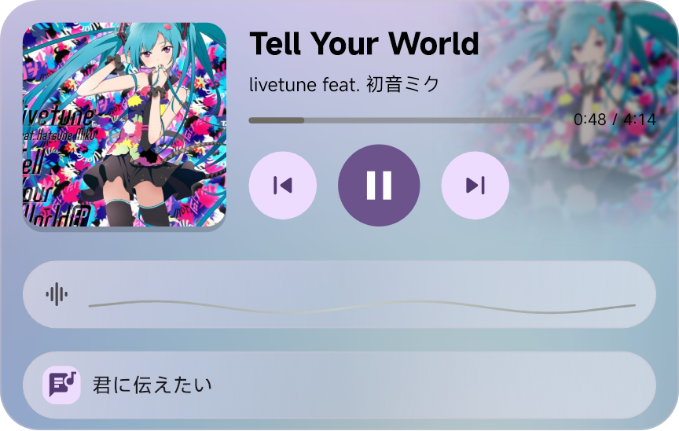
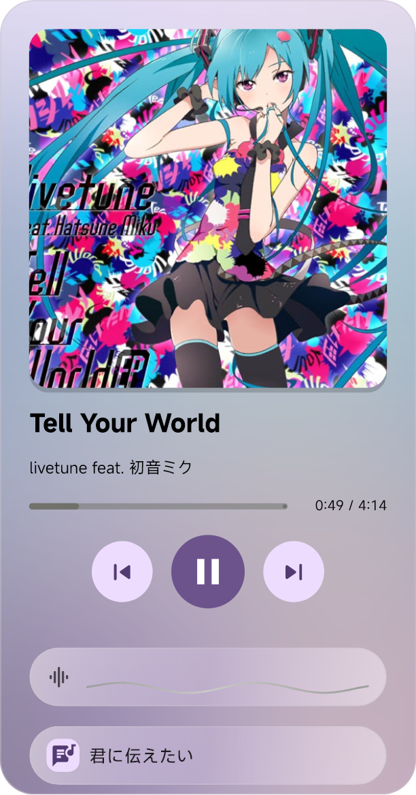
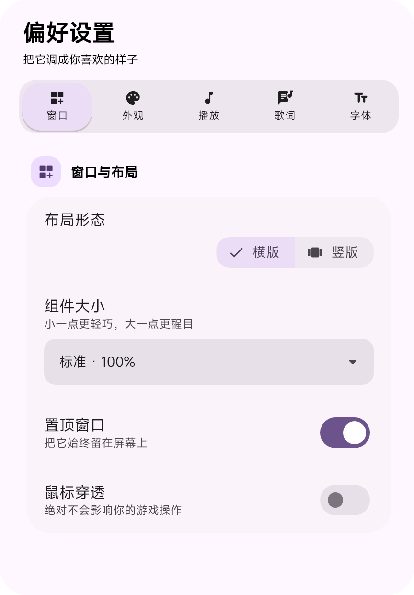

<div align="center">


<h1>MD3 Music Widget</h1>

<p><strong>让喜欢的音乐，留在你的画面里。</strong></p>

<p>一张适合桌面与直播的 Windows 音乐卡片。</p>

[](CHANGELOG.md)
[](#开始使用)
[](#工作原理)
[](docs/native_capture.md)

[**下载**](#下载与版本选择) · [预览](#预览) · [功能](#核心功能) · [更新记录](CHANGELOG.md) · [使用与自定义](docs/customization.md)

</div>

---

正在播放的歌曲、封面、歌词与频谱，不必藏在播放器里。MD3 Music Widget 把它们放进一张 Material 3 风格的卡片：日常听歌时留在桌面，直播时也可以隐藏播放按钮，只展示音乐。

## 预览

<p align="center">
  <a href="docs/media/player-horizontal.png"></a>
</p>

<p align="center"><sub>横版 · 留出桌面空间，也适合放在直播画面的一角</sub></p>

<table>
  <tr>
    <td align="center" width="42%"><strong>竖版</strong></td>
    <td align="center" width="58%"><strong>偏好设置</strong></td>
  </tr>
  <tr>
    <td align="center" valign="top"><a href="docs/media/player-vertical.png"></a></td>
    <td align="center" valign="top"><a href="docs/media/settings.png"></a></td>
  </tr>
</table>

预览曲目为 **《Tell Your World》— livetune feat. 初音ミク**。图片由实际 Flutter 组件渲染；播放位置与频谱为演示数据，不是真实播放器采集或桌面录屏，也不是性能／分层质量测试。[曲目与封面来源](docs/media/README.md) · 点击图片可查看原图。

## 下载与版本选择

**文档对应 1.2.1。** 首次使用，想体验封面分层就选有模型版；更在意下载大小，可以先用无模型版。下面列出本版套件内容，在线下载以 [GitHub 已发布的文件](https://github.com/Sylvain-cjh/MD3MusicWidget-Flutter/releases) 为准。

| 版本 | 适合谁 | 安装版 | 免安装版 |
| --- | --- | --- | --- |
| **有分层模型版** | 想使用封面分层视差；包含模型、GPU 依赖和许可 | 有模型版 Setup EXE | 有模型版 Portable ZIP |
| **无分层模型版** | 先使用歌曲、歌词、频谱与普通 3D 卡片，需要时再补装模型 | 无模型版 Setup EXE | 无模型版 Portable ZIP |
| **独立 cover-layers** | 给匹配版本的无模型应用补装／更新分层，不是独立播放器 | [补装说明](docs/layer_models.md) | [模型仓库](https://github.com/Sylvain-cjh/cover-layers) |

[查看全部发行版本](https://github.com/Sylvain-cjh/MD3MusicWidget-Flutter/releases) · [本次更新了什么](CHANGELOG.md)

独立模型的在线文件以模型仓库实际发布内容为准，补装前确认主程序版本。应用与模型套件分别使用文件夹区分，Portable 和源码是各自独立的 ZIP，不再套一层总压缩包。

> [!IMPORTANT]
> 当前支持 **Windows x64**。读取歌曲需要播放器公开 Windows 系统媒体会话（SMTC）。本机网易云测试版本能上报歌曲和封面，但没有有效总时长；缺少时间线时，不保证进度、时间驱动歌词和下一首预告可用。程序不会猜测这些数据。

## 核心功能

| | 功能 | 用起来是什么样 |
| --- | --- | --- |
| 🎵 | **正在播放** | 歌名、歌手、封面和进度集中展示，可显示已播／总时长；文字按背景明暗自动反色。播放按钮可以整体隐藏。 |
| 🎨 | **跟着封面换心情** | 动态取色、流光、渐变封面、左右光效与玻璃质感；深色模式关闭流光后，可选择 OLED 模式。 |
| ↔️ | **横竖都合适** | 横版与竖版连续切换，提供 82%、100%、122% 和锁定宽高比的自由缩放；竖版不保留右侧附加封面。 |
| 〰️ | **真实音乐频谱** | 柱状、镜像和平滑波形可选，粗细连续调节，柱数可自动适应或手动设为 1–128 根。不用随机动画冒充音频。 |
| 📝 | **歌词与消散** | 支持 QQ、网易云、AMLL、LRCLIB 和本地歌词；有真实逐字时间时，可选高亮或唱完后烟雾消散，进出场也可分别设置。 |
| ⏭️ | **恰好出现的下一首** | 从本地或 QQ／网易云公开歌单推算，在歌曲临近结束时出现，不常驻、不留空白占位。它不是播放器实际队列。 |
| 📈 | **顺便看看电脑状态** | FPS、CPU、GPU、内存独立开关；FPS 面向选择的游戏／程序，其余为整机指标。只开一两项时显示趋势波形。 |
| 🔤 | **自己的字体与节奏** | 内置 MiSans VF，歌词可独立设字体、字重和字号；数值支持连续滑动、双击输入和重置，并适配系统减少动画设置。 |

更多可调项目和具体行为见 [外观、动画与缓存](docs/customization.md)。

## 开始使用

1. **选版本。** 运行 Setup 安装，或将 Portable ZIP 完整解压到普通文件夹；先读包内的 `使用说明.txt`。
2. **播放音乐。** 开启播放器的系统媒体控制。默认自动跟随当前来源，也可以在挂件设置中固定采集程序。
3. **调成喜欢的样子。** 右键进入设置，选择布局、歌词、频谱和字体。需要只展示音乐时，可关闭三个播放控件。

> [!NOTE]
> 默认音乐采集已经内置，**不需要另开 MusicFetcher，也不需要为音乐采集安装 .NET**。FPS 所用 PresentMon 仍随程序保留。

- 系统要求：Windows 10 2004（Build 19041）或更新版本，包括 Windows 11，x64。
- 指定程序的进程级频谱额外要求 Build 20348 或更新版本，以及可用的系统／设备支持；失败时不偷偷改采整机音频。自动模式可使用系统回环。
- 不要只复制 EXE，需保留 `data/`、`images/`、`runtime/` 和 DLL 的相对位置。
- 鼠标穿透开启后，点击托盘图标可恢复交互；完全退出使用托盘菜单。

> [!WARNING]
> 当前签名使用自签名证书，其他电脑仍可能提示未知发布者，不等同于公共受信任签名。程序不会自动安装信任根证书；发行文件不附带哈希清单。

## 工作原理

应用由 **Flutter 界面、进程内 Windows 媒体／音频采集，以及可选 GPU 分层模块**组成。

- **歌曲信息与控制**：后台 C++/WinRT 读取系统媒体会话，传递标题、封面、状态与时间线，并发送播放命令。不启动外置音乐采集进程，不监听旧采集端口。
- **频谱**：WASAPI 回环采集音频，进程内 DSP 生成频段数据。关闭频谱会释放对应采集；指定来源只接受精确匹配。
- **歌词与歌单**：独立 Provider 查询在线资源或读取本地文件。有效歌词先读缓存，暂时失败有限重试；显示实际来源，不把后备结果冒充主源。
- **画面与分层**：Flutter 绘制主题、文字与动画。可选模型通过 DirectML 在兼容核显上生成蒙版和景深视差，不逐帧推理，不以 CPU／独显推理回退；它不是完整 3D 网格重建。

| 想了解 | 继续阅读 |
| --- | --- |
| 播放器识别、系统要求和时间线限制 | [内置音乐采集](docs/native_capture.md) |
| 歌词格式、逐字高亮和烟雾消散 | [逐字歌词](docs/word_lyrics.md) |
| 网易云歌词与公开歌单 | [网易云支持](docs/netease_support.md) |
| 模型补装、硬件与分层边界 | [cover-layers](docs/layer_models.md) |
| FPS、CPU、GPU、内存的采集方式 | [性能监视器](docs/performance_monitor.md) |
| 字体、动画、窗口和缓存参数 | [使用与自定义](docs/customization.md) |

## 常见问题

<details>
<summary>能看到歌名，但进度、歌词定位或下一首不正常？</summary>

歌名、封面和时间线是不同字段。播放器可能只公开其中一部分；缺少可靠时间线时，不能用挂件启动时间代替歌曲进度。先确认播放器已开启 SMTC，并检查是否固定选择了其他来源。

</details>

<details>
<summary>歌词能显示，为什么没有逐字或烟雾效果？</summary>

这些效果需要真实的字／词级时间轴。普通 LRC 或未知格式会保留整句显示，不按平均时长伪造逐字数据。QQ／网易云未命中时会尝试可用后备来源，但资源覆盖、歌曲版本和网络限制仍可能导致缺词。

</details>

<details>
<summary>为什么有时没有频谱或 FPS？</summary>

频谱可能受独占输出、受保护内容、虚拟声卡、系统版本与设备支持影响。指定程序无法精确匹配时不会扩大采集范围。

FPS 读取所选程序的呈现事件，不是桌面帧率或显示器刷新率。没有持续呈现、路径不受支持或 ETW 权限不足时显示“—”；如设置提示权限不足，可选择手动授权管理员重启，不会静默提权。GPU 计数器不可用时也不制造读数。

</details>

<details>
<summary>缓存会保存什么？会读取账号或私人歌单吗？</summary>

歌词和背景缓存默认保存在 `%LOCALAPPDATA%\MD3MusicWidget\cache-v1`，退出或关机后仍可复用，可更换目录、设置上限或清理。清理不会删除个人 LRC、歌单或其他文件。背景保存源图和色调，不是最终 GPU 纹理；磁盘上限也不是运行内存上限。

歌曲与音频主要在本机处理；在线歌词和公开歌单查询会访问对应服务，发送匹配所需的歌曲信息。歌词查询直连，不读取系统 HTTP 代理。程序不要求账号 Cookie，不读取私人数据库，也不绕过私有歌单权限；可改用本地歌单。随机播放、单曲循环、临时插播或匹配不唯一时，下一首推算可能不可用。

</details>

## 源码与自定义

默认构建需要 Flutter Windows 开发环境和 Visual Studio C++ 桌面开发组件，不需要先发布 MusicFetcher 或安装 .NET SDK。

```sh
flutter pub get
flutter build windows --release
```

旧采集源码仅保留为显式开发回退，原生失败不会自动启用。程序源码发行不包含 PowerShell／Inno 发布脚本、私人训练数据或实验检查点。

修改设置文案：名称与选项在 `lib/ui/widgets/settingsLabels.dart`，说明小字在 `lib/ui/widgets/settingsDescriptions.dart`。README 介绍软件，CHANGELOG 只记录当前版本更新。

## 许可与致谢

应用目前未附带开源许可证，在明确授权前默认保留所有权利。源码可查看不等于整款应用已采用 MIT 等开源许可。

- PresentMon：独立 MIT 许可证，来源及许可见 `third_party/presentmon/`。
- QQ／网易云主题图标：来自 Lawnicons 社区图标库，Apache-2.0 许可，原 SVG、许可证与来源见 `assets/brand/lawnicons/`。不代表 Google 官方品牌图标或品牌方授权。
- MiSans VF：已随应用内置，说明见 [MiSans 使用通知](assets/fonts/MiSans-NOTICE.txt) 与 [官方协议](https://hyperos.mi.com/font/zh/download/)。
- 模型、DirectML、ONNX Runtime 与其他依赖：保留各自随附的完整许可和来源，第三方许可不适用于整个应用。

---

<p align="center"><sub>音乐照常播放，画面留给你。</sub></p>
