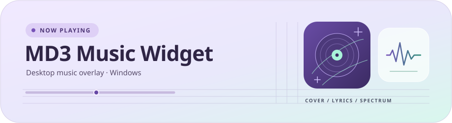
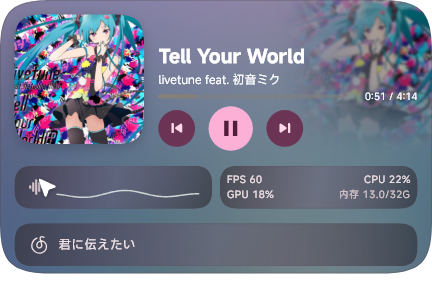
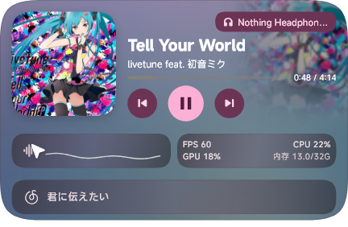
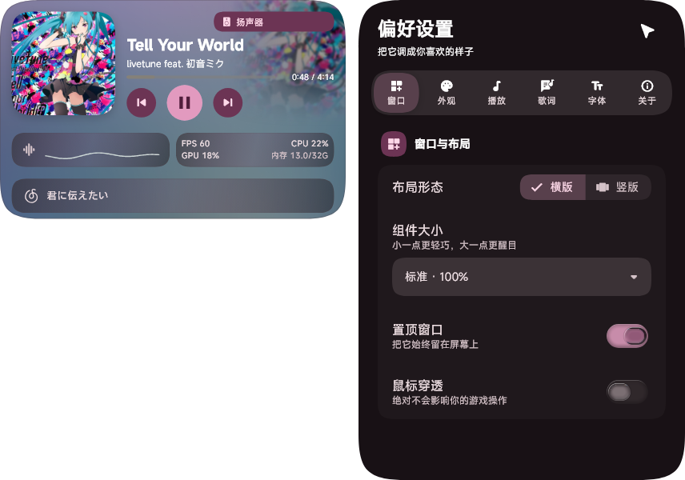
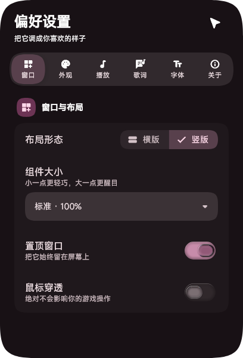

<div align="center">

<a href="https://github.com/journey-ad/Moe-Counter"></a>

<picture>
  <source media="(prefers-color-scheme: dark)" srcset="assets/logo-dark.png">
  
</picture>

<h1>MD3 Music Widget</h1>

<p><strong>把正在听的歌，留在桌面或直播画面里。</strong><br/>不换播放器，也不挡住你正在做的事。</p>

[](CHANGELOG.md)
[](#开始使用)
[](#工作原理)
[](docs/native_capture.md)

[**下载**](#下载与版本选择) · [功能演示](#功能演示) · [开始使用](#开始使用) · [常见问题](#常见问题)



</div>

---

音乐照常在 QQ 音乐、网易云或你习惯的播放器里播放。挂件负责把封面、歌词和真实频谱放到你想要的位置。

## 下载与版本选择

**第一次用，建议先选无模型版。** 它保留封面、歌词、频谱、性能监视器和普通 3D 悬浮效果。只有想让封面里的主体和背景产生不同深度的视差时，才需要分层模型。

| 1.3.3 套件 | 适合谁 |
| --- | --- |
| **无分层模型版** · `Without-Layer-Models` | 想看歌曲、封面、歌词、频谱，或给直播做展示。 |
| **有分层模型版** · `With-Layer-Models` | 想让封面主体与背景有不同景深；需要兼容核显。 |

两种版本都有 `Setup.exe` 安装包和 `Portable.zip` 免安装包，任选其一即可。源码 ZIP 不用于直接运行。已发布的附件见 [GitHub 发行页](https://github.com/Sylvain-cjh/MD3MusicWidget-Flutter/releases)。

1.3.3 的有模型版沿用上一版的正式模型，本次不单独发行 cover-layers。需要模型请选有模型版，详见 [分层模型说明](docs/layer_models.md)。

> [!IMPORTANT]
> 主程序要求 **Windows 10 2004（Build 19041）或更新版本，包括 Windows 11，x64**。播放器需要开启系统媒体控制，挂件才能读取正在播放的信息。指定进程频谱和可选分层另有系统或硬件要求。

## 功能演示

<p align="center">
  <a href="docs/media/demo-playback.png"></a>
</p>

<p align="center"><sub>播放 · 歌词 · 频谱与性能监视</sub></p>

<p align="center">
  <a href="docs/media/demo-output.png"></a>
</p>

<p align="center"><sub>输出设备与音量</sub></p>

<p align="center">
  <a href="docs/media/demo-layout.png"></a>
</p>

<p align="center"><sub>横竖布局切换</sub></p>

<p align="center">
  <a href="docs/media/demo-settings.png"></a>
</p>

<p align="center"><sub>偏好设置</sub></p>

<p align="center"><a href="docs/media/player-horizontal.png">横版截图</a> · <a href="docs/media/player-vertical.png">竖版截图</a> · <a href="docs/media/audio-devices.png">输出设备截图</a> · <a href="docs/media/settings.png">设置截图</a> · <a href="docs/media/README.md">素材与演示说明</a></p>

## 这次更新

- **设备面板从原位展开。** 宽度先打开，设备列表再铺开；设备名与音量行分段交接，收回时回到同一枚胶囊。
- **窗口与设置动效重新调校。** 横竖切换、设置展开和右键菜单使用无回弹的非线性过渡，按各自的距离和用途调整节奏。
- **歌词来源只留标识。** QQ 音乐、网易云、LRCLIB 等不再显示独立底牌，标识随深浅主题调整。

## 界面中的其他功能

- **外观 → 液态玻璃。** 导航滑块会弯折它后面的画面，开关不按住也有玻璃质感。喜欢原来的 MD3 样式，关掉就好。
- **关于 → 检查更新。** 看当前版本、跳到项目源码或查正式发行。检查由你手动触发，不会自动下载。
- **关于 → 开源许可。** 可以按组件搜索，再展开看许可内容。
- **「浮拍」图标有深浅两版。** 「关于」页随挂件主题换色，Windows 托盘随任务栏换色。

[查看本版完整更新记录](CHANGELOG.md)

## 核心功能

| | 功能 | 用起来是什么样 |
| --- | --- | --- |
| 🎵 | **正在播放** | 歌名、歌手、封面和进度集中展示，可显示已播／总时长；文字按背景明暗自动反色。播放按钮可以整体隐藏。 |
| 🎨 | **跟着封面换心情** | 动态取色、流光、渐变封面、左右光效与玻璃质感；深色模式关闭流光后，可选择 OLED 模式。 |
| ↔️ | **横竖都合适** | 横版与竖版连续切换，提供 82%、100%、122% 和锁定宽高比的自由缩放；竖版不保留右侧附加封面。 |
| 〰️ | **真实音乐频谱** | 柱状、镜像和平滑波形可选，粗细连续调节，柱数可自动适应或手动设为 1–128 根。不用随机动画冒充音频。 |
| 📝 | **歌词与消散** | 支持 QQ、网易云、AMLL、LRCLIB 和本地歌词；有真实逐字时间时，可选高亮或唱完后烟雾消散，进出场也可分别设置。 |
| ⏭️ | **恰好出现的下一首** | 从本地或 QQ／网易云公开歌单推算，在歌曲临近结束时出现，不常驻、不留空白占位。它不是播放器实际队列。 |
| 📈 | **顺便看看电脑状态** | FPS、CPU、GPU、内存独立开关；FPS 面向选择的游戏／程序，其余为整机指标。只开一两项时显示趋势波形。 |
| 🔤 | **自己的字体与节奏** | 内置 MiSans VF，歌词可独立设字体、字重和字号；数值支持连续滑动、双击输入和重置，并适配系统减少动画设置。 |

更多可调项目和具体行为见 [外观、动画与缓存](docs/customization.md)。

## 开始使用

1. **打开挂件。** 运行 Setup 安装，或完整解压 Portable ZIP 后运行主程序。免安装版不要只复制 EXE；请保留同目录下的数据、资源与运行文件。
2. **先让播放器播一首歌。** 在 QQ 音乐、网易云音乐等播放器中开启系统媒体控制。挂件默认自动跟随系统媒体会话；有多个播放器时，可以在设置里固定采集程序。
3. **右键打开设置。** 想用作直播展示，可关闭播放控件，再按需开启歌词、频谱、下一首预告或鼠标穿透。开启穿透后，点击托盘图标可恢复交互。

> [!NOTE]
> 默认音乐采集已经内置，**不用另开 MusicFetcher，也不用为音乐采集安装 .NET**。FPS 监视器使用的 PresentMon 仍随程序提供。

挂件里的三个来源可以分别选择：

| 设置 | 决定什么 |
| --- | --- |
| **采集程序** | 从哪个播放器读取正在播放的歌、封面和进度。 |
| **歌词来源** | 到哪里找这首歌的歌词，不需要与播放器是同一家。 |
| **歌单来源** | 从哪个本地歌单或 QQ／网易云公开歌单推算下一首，不会读取播放器的私人队列。 |

> [!WARNING]
> 发行文件使用自签名证书，Windows 仍可能提示未知发布者；这不等同于公共受信任签名。程序不会自动把证书加入系统信任。

## 工作原理

应用由 **Flutter 界面、进程内 Windows 媒体／音频采集，以及可选 GPU 分层模块**组成。

### 一首歌怎么走到屏幕上

| 输入 | 挂件拿到什么 | 画面上看到什么 |
| --- | --- | --- |
| 播放器的 Windows 媒体会话 | 曲目、封面、状态和时间线 | 标题、进度、主题颜色 |
| 真实音频输出 | 各频段的能量 | 随音乐变化的波形或频谱柱 |
| 歌词源与所选歌单 | 歌词时间轴、可用的后续曲目 | 当前歌词、临近结束的下一首提示 |

- **歌曲信息与控制**：后台 C++/WinRT 读取系统媒体会话，传递标题、封面、状态与时间线，并发送播放命令。不启动外置音乐采集进程，不监听旧采集端口。
- **频谱**：WASAPI 回环采集音频，进程内 DSP 生成频段数据。关闭频谱会释放对应采集；指定来源只接受精确匹配。
- **歌词与歌单**：独立 Provider 查询在线资源或读取本地文件。有效歌词先读缓存，暂时失败有限重试；显示实际来源，不把后备结果冒充主源。
- **画面与分层**：Flutter 绘制主题、文字与动画。可选模型通过 DirectML 在兼容核显上生成蒙版和景深视差，不逐帧推理，不以 CPU／独显推理回退；它不是完整 3D 网格重建。

| 想了解 | 继续阅读 |
| --- | --- |
| 播放器识别、系统要求和时间线限制 | [内置音乐采集](docs/native_capture.md) |
| 歌词格式、逐字高亮和烟雾消散 | [逐字歌词](docs/word_lyrics.md) |
| 网易云歌词与公开歌单 | [网易云支持](docs/netease_support.md) |
| 模型补装、硬件与分层边界 | [cover-layers](docs/layer_models.md) |
| FPS、CPU、GPU、内存的采集方式 | [性能监视器](docs/performance_monitor.md) |
| 字体、动画、窗口和缓存参数 | [使用与自定义](docs/customization.md) |

## 常见问题

<details>
<summary>能看到歌名，但进度、歌词定位或下一首不正常？</summary>

先确认播放器已开启系统媒体控制，并检查挂件有没有固定到另一个采集程序。如果歌名和封面正常，也可能只是播放器没有上报可靠的时间线：本机测试过的网易云客户端就出现过只上报歌曲、封面，不提供有效总时长的情况。挂件不会补造进度，依赖时间的歌词定位和下一首预告也可能暂不可用。

</details>

<details>
<summary>歌词能显示，为什么没有逐字或烟雾效果？</summary>

这些效果需要真实的字／词级时间轴。普通 LRC 或未知格式会保留整句显示，不按平均时长伪造逐字数据。QQ／网易云未命中时会尝试可用后备来源，但资源覆盖、歌曲版本和网络限制仍可能导致缺词。

</details>

<details>
<summary>为什么有时没有频谱或 FPS？</summary>

指定程序的频谱需要 Windows Build 20348 或更新版本，也可能受独占输出、受保护内容、虚拟声卡和设备支持影响。指定来源匹配失败时不会改采整机音频；想看系统输出的频谱，可以切回自动模式。

FPS 读取所选程序的呈现事件，不是桌面帧率或显示器刷新率。没有持续呈现、路径不受支持或 ETW 权限不足时显示“—”；如设置提示权限不足，可选择手动授权管理员重启，不会静默提权。GPU 计数器不可用时也不制造读数。

</details>

<details>
<summary>缓存会保存什么？会读取账号或私人歌单吗？</summary>

歌词和背景缓存默认保存在 `%LOCALAPPDATA%\MD3MusicWidget\cache-v1`，退出或关机后仍可复用，可更换目录、设置上限或清理。清理不会删除个人 LRC、歌单或其他文件。背景保存源图和色调，不是最终 GPU 纹理；磁盘上限也不是运行内存上限。

歌曲与音频主要在本机处理；在线歌词和公开歌单查询会访问对应服务，发送匹配所需的歌曲信息。歌词查询直连，不读取系统 HTTP 代理。程序不要求账号 Cookie，不读取私人数据库，也不绕过私有歌单权限；可改用本地歌单。随机播放、单曲循环、临时插播或匹配不唯一时，下一首推算可能不可用。

</details>

## 源码与自定义

默认构建需要 Flutter Windows 开发环境和 Visual Studio C++ 桌面开发组件，不需要先发布 MusicFetcher 或安装 .NET SDK。

```sh
flutter pub get
flutter build windows --release
```

旧采集源码仅保留为显式开发回退，原生失败不会自动启用。程序源码发行不包含 PowerShell／Inno 发布脚本、私人训练数据或实验检查点。

修改设置文案：名称与选项在 `lib/ui/widgets/settingsLabels.dart`，说明小字在 `lib/ui/widgets/settingsDescriptions.dart`。README 介绍软件，CHANGELOG 只记录当前版本更新。

## 许可与致谢

应用目前未附带开源许可证，在明确授权前默认保留所有权利。源码可查看不等于整款应用已采用 MIT 等开源许可。

- PresentMon：独立 MIT 许可证，来源及许可见 `third_party/presentmon/`。
- QQ／网易云主题图标：来自 Lawnicons 社区图标库，Apache-2.0 许可，原 SVG、许可证与来源见 `assets/brand/lawnicons/`。不代表 Google 官方品牌图标或品牌方授权。
- MiSans VF：已随应用内置，说明见 [MiSans 使用通知](assets/fonts/MiSans-NOTICE.txt) 与 [官方协议](https://hyperos.mi.com/font/zh/download/)。
- 模型、DirectML、ONNX Runtime 与其他依赖：保留各自随附的完整许可和来源，第三方许可不适用于整个应用。

---

<p align="center"><sub>音乐照常播放，画面留给你。</sub></p>
